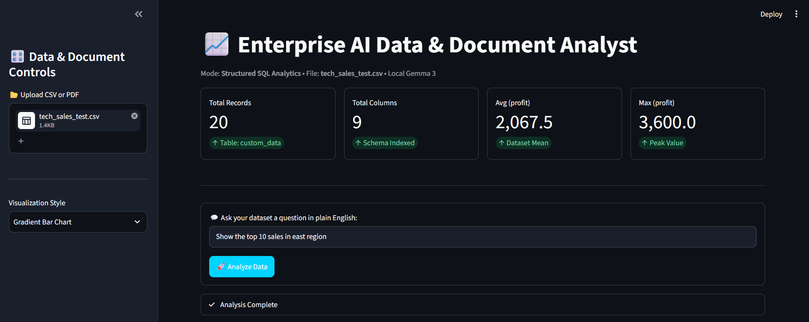
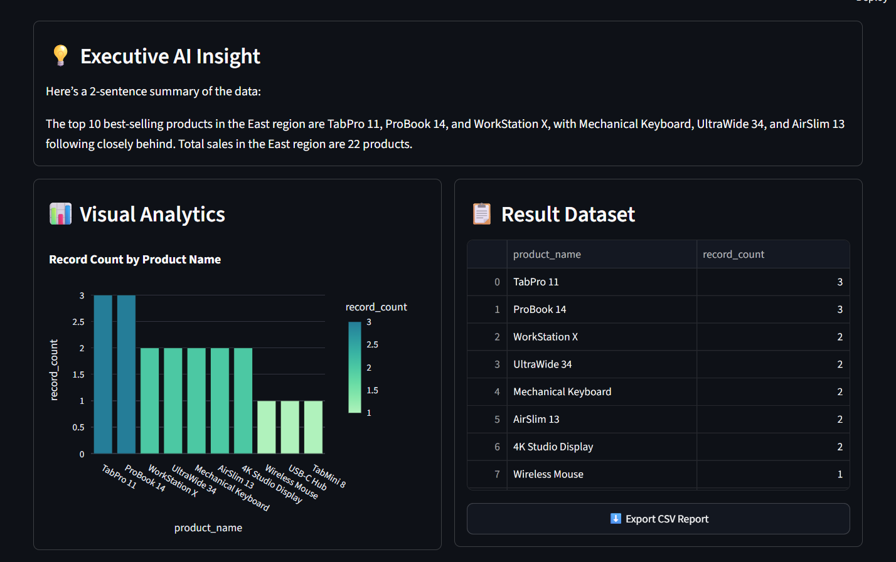
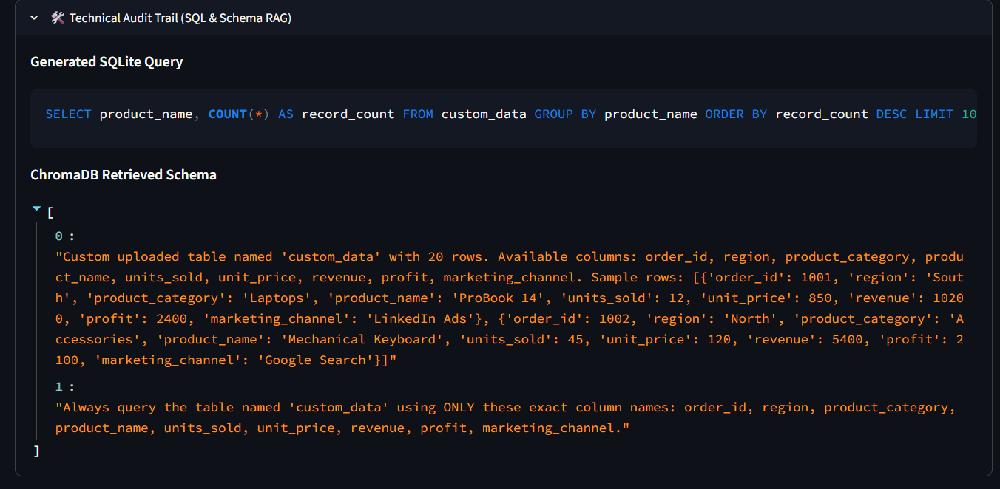

# 📈 Hybrid Enterprise AI Data & Document Analyst

A local-first **Hybrid Agentic RAG & Text-to-SQL Analytics Platform** built with **Python, SQLite, ChromaDB, Ollama (`gemma3:1b`), Plotly, and Streamlit**. 

Users can upload either **structured CSV spreadsheets** or **unstructured PDF reports** to query data in plain English, generate interactive BI charts, and extract page-cited document answers—with **100% local execution** and **zero cloud API costs**.

---

## 📸 Live Dashboard Preview

### 1. Executive KPI Cards & Plain-English Query Bar


### 2. Automated AI Insights, Plotly Charts & Exportable Data


### 3. Technical Audit Trail (Self-Corrected SQL & ChromaDB Schema RAG)


---

## 🏗️ System Architecture

The system separates **deterministic math (SQLite)** from **semantic reasoning (ChromaDB + Gemma 3)** to eliminate LLM calculation errors and schema hallucinations:

```text
[User Upload: CSV or PDF]
         │
         ├──► CSV File ──► SQLite (company_data.db) + Schema Rules ──► ChromaDB (all-MiniLM-L6-v2)
         │                      │
         │                      ▼
         │             Gemma 3 (Ollama) ──► Self-Correcting SQL Loop (3 Retries) ──► Plotly BI Dashboard
         │
         └──► PDF File ──► Chunking (pypdf) ──► ChromaDB Vector Store ──► Semantic Search ──► Cited Answer
```

---

## ✨ Key Features

* **Schema RAG (Anti-Hallucination):** Stores plain-English column descriptions and business rules in **ChromaDB** (`all-MiniLM-L6-v2` embeddings) so the LLM retrieves exact column names before writing SQL.
* **Self-Correcting Text-to-SQL Loop:** Executes generated SQLite queries inside a 3-attempt validation loop—automatically catching syntax errors, feeding the error back to `gemma3:1b`, and rewriting broken queries.
* **Automated BI Dashboard:** Dynamically updates top KPI cards, renders interactive **Plotly** visualizations (Bar, Line, Area), generates a 2-sentence executive summary, and supports 1-click CSV report exports.
* **PDF Document RAG with Citations:** Splits uploaded PDFs into overlapping chunks with page metadata and answers user questions grounded strictly in retrieved passages with exact page citations.
* **100% Local & Private:** Powered by **Ollama (`gemma3:1b`)** and **SQLite**, ensuring sensitive enterprise files never leave the local machine.

---

## 🛠️ Tech Stack

* **Frontend & Dashboard:** Streamlit, Plotly
* **LLM & Orchestration:** Ollama (`gemma3:1b`), LangChain (`langchain-ollama`)
* **Vector Database & Embeddings:** ChromaDB, `all-MiniLM-L6-v2` (384-dim embeddings)
* **Data Engine & Parsing:** SQLite (`sqlite3`), Pandas, `pypdf`

---

## 📂 Project Structure

```text
Autonomous-Data-Analyst/
├── .streamlit/
│   └── config.toml                # Custom dark BI dashboard theme
├── assets/
│   ├── dashboard_overview.png     # Screenshot of KPI cards & query bar
│   ├── visual_analytics.png       # Screenshot of Plotly chart & AI summary
│   └── technical_audit_trail.png  # Screenshot of SQL & ChromaDB audit view
├── data/
│   ├── company_data.db            # Local SQLite database
│   └── schema_docs.json           # Plain-English schema dictionary & rules
├── app.py                         # Main Streamlit Hybrid CSV & PDF Analyst app
├── setup_data.py                  # Script to initialize SQLite database & schema JSON
├── build_rag.py                   # Script to index schema descriptions into ChromaDB
├── requirements.txt               # Project dependencies
└── README.md                      # Project documentation
```

---

## 🚀 How to Run Locally

1. **Clone the repository:**
   ```bash
   git clone https://github.com
   cd autonomous-data-analyst
   ```

2. **Create and activate a virtual environment:**
   ```bash
   python -m venv venv
   # Windows:
   venv\Scripts\activate
   # Mac/Linux:
   source venv/bin/activate
   ```

3. **Install dependencies:**
   ```bash
   pip install -r requirements.txt
   ```

4. **Pull the local LLM via Ollama:**
   ```bash
   ollama pull gemma3:1b
   ```

5. **Initialize the database and vector store:**
   ```bash
   python setup_data.py
   python build_rag.py
   ```

6. **Launch the Streamlit dashboard:**
   ```bash
   streamlit run app.py
   ```
